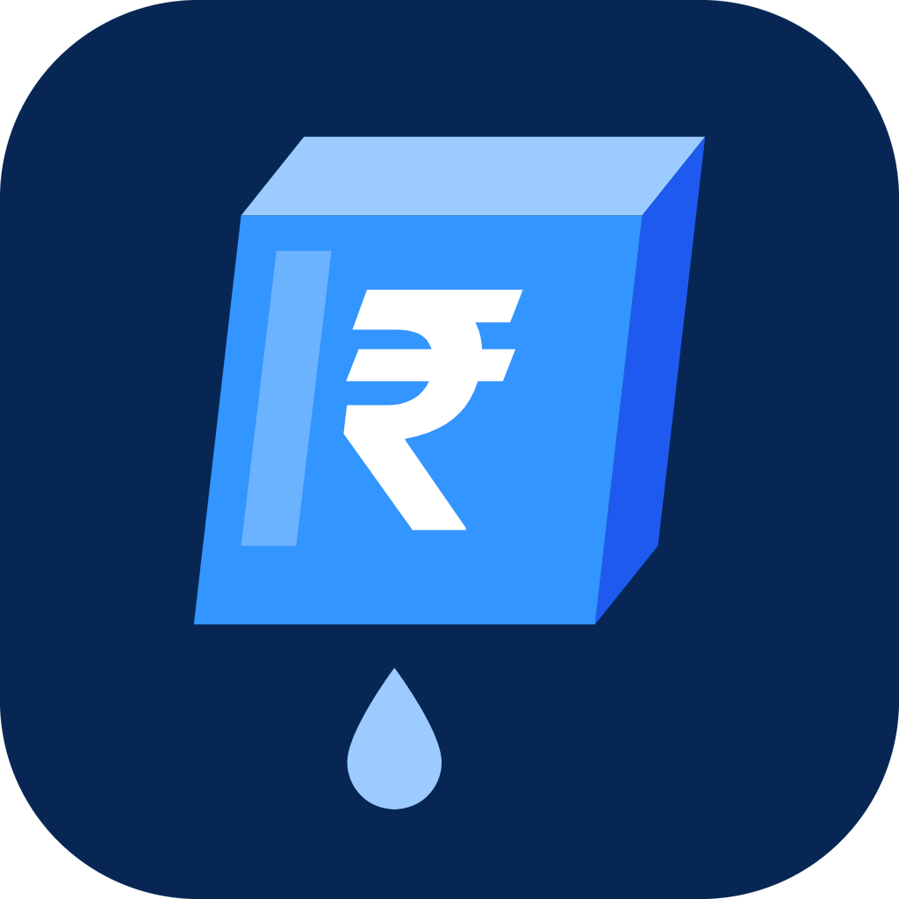
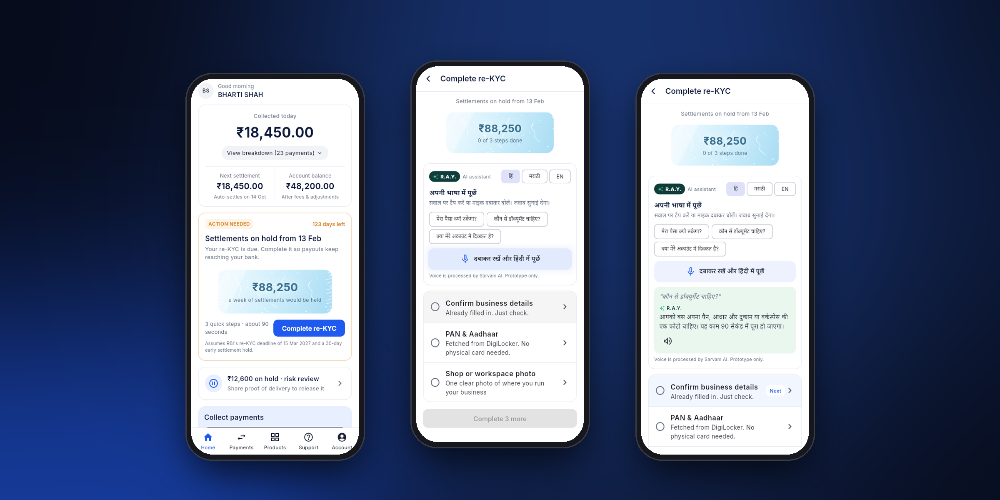

<p align="center">
  
</p>

<h1 align="center">QuickUnfreeze</h1>

<p align="center">
  <b>Settlement holds, explained and fixed on the phone.</b><br>
  A concept feature for the Razorpay merchant app.
</p>

<p align="center">
  <a href="https://rzp-unfreeze.vercel.app"><b>Try the web app</b></a> ·
  <a href="https://rzp-unfreeze.vercel.app/unfreeze.apk"><b>Download the Android APK</b></a> ·
  <a href="docs/solutions/01-unfreeze-product-brief.md">Product brief</a>
</p>

<p align="center">
  
</p>

---

"My money stopped and nobody told me why" is the loudest complaint in Razorpay's Play Store reviews, across holds and KYC blocks. QuickUnfreeze turns it into a 90-second fix on the phone, starting with re-KYC.

## Who it's for

Bharti is a home baker in Nagpur. She runs her business from one phone and collects through Payment Links. Her settlements are her working capital, and she's more at home in Hindi or Marathi than in English forms.

- **Segment:** no-code micro merchants (1–10 people) in Tier 1–3 cities, collecting ~₹0.5–5 lakh a month through Payment Links or QR.
- **Phone-first:** 71% of MSMEs (84% of women entrepreneurs) run their business mainly on a smartphone (PayNearby MSME Digital Index 2025).
- **Her job to be done:** "Tell me **early**, in **my language**, and let me **fix it** between orders."

## The problem today

She finds out from a missing bank credit, with no reason given and a fix that only works on a desktop.

| Top complaints in 498 merchant 1–2★ Play Store reviews | Share |
|---|---|
| Unreachable support | 18% |
| KYC rejected, no reason | 18% |
| Held funds | 12% |

> *"They said my account is fully activated… now they say settlement would take 120 days."*
> The most-upvoted review (266 upvotes)

If the reported 15 Mar 2027 deadline holds, re-KYC holds start around 13 Feb, and 30–35% of small merchants may miss it.

## What QuickUnfreeze does

One pattern for every hold: **why → what's needed → fix on the phone → track.**

| | Today | With QuickUnfreeze |
|---|---|---|
| **Finds out** | From a missing bank credit | A push notification and a home card, months ahead |
| **Understands** | No reason; English-only email | Taps a question or asks by voice in Hindi or Marathi, and hears the answer |
| **Fixes** | Borrows a laptop, finds files, uploads | Three steps on the phone: confirm details → DigiLocker → one photo |
| **Afterwards** | Tickets, then days of waiting | *Submitted ✓*, a status tracker, and "Talk to a person" with the case attached |

**The flow, in about 90 seconds:** alert (0:00) → ask R.A.Y. why (0:15) → confirm pre-filled details (0:30) → PAN & Aadhaar via DigiLocker (0:45) → workspace photo, checked by AI → **Submitted ✓** (1:15).

A risk hold that's already in place (₹12,600, two flagged orders) follows the same pattern: R.A.Y. explains why, and she adds proof of delivery from her gallery.

### R.A.Y., in her language

QuickUnfreeze extends R.A.Y., Razorpay's assistant, into the hold flow. It answers by voice in Hindi or Marathi, knows her case (why this hold, what's needed), and handles follow-up "why" questions without leaving the task.

```
 her voice ──► Sarvam (speech → text) ──► Gemini (writes the answer from her case) ──► Sarvam (text → speech) ──► she hears it
```

## Why mobile

- **Push** reaches her months ahead, on the phone she checks all day.
- The **DigiLocker OTP** lands on the same phone and fills itself in.
- The **camera** checks the one photo before it's sent.
- **Voice** works in her language.

## Decisions and what I didn't build

Warn early, resolve fast. AI advises; a person decides.

- **One pattern for every hold.** AI is used only for R.A.Y.'s answers and the photo check.
- ✕ **AI releasing holds or approving KYC:** money and compliance need a human.
- ✕ **R.A.Y. in a side panel or chat:** it sits inside the hold flow, in context.
- ✕ **AI blocking the photo:** after one retake she can "submit anyway", and a person reviews it.
- ✕ **Exact fraud-check triggers:** they'd help fraudsters. She sees a plain reason ("orders larger than usual").

## How I'll measure it

One North Star for every hold: how many days the money sits on hold.

| Metric | Target |
|---|---|
| **North Star: hold-days per case** | ≤ 1 day |
| Self-serve resolution (no support ticket) | ≥ 80% |
| Time to act (alert → Submitted) | < 2 min |
| Guardrail: fraud, losses on released holds | no rise |

| Assumption | How I'd validate it |
|---|---|
| Hold date | RBI circular |
| Friction causes missed re-KYC | Re-KYC funnel drop-off |
| "Submitted" counts as compliant | Risk team sign-off |
| ~90 s on a phone | 5-merchant timed test |

## The prototype

| | |
|---|---|
| **Web** | [rzp-unfreeze.vercel.app](https://rzp-unfreeze.vercel.app). On desktop it shows a phone frame with a guided side panel. |
| **Android** | [unfreeze.apk](https://rzp-unfreeze.vercel.app/unfreeze.apk) |
| **Live AI** | Gemini Flash-Lite (answers, photo check) · Sarvam Saaras v3 (speech-to-text) and Bulbul v3 (text-to-speech) |
| **Mocked** | DigiLocker, the KYC review and visit booking |
| **Stack** | Flutter (one codebase for web and Android) · a single Vercel function as the AI and voice proxy · Google Analytics 4, split by surface (phone web, desktop web, Android app) |

Every AI call has a time limit and a bundled fallback in the chosen language, so the flow never breaks on a bad connection.

### Run it locally

```bash
cd unfreeze
flutter pub get
flutter run --dart-define=APP_TOKEN=<token>   # Android device or Chrome
npm test && flutter test                      # API and app tests
```

The API (`unfreeze/api/index.js`) reads `GEMINI_API_KEY`, `SARVAM_API_KEY`, `APP_TOKEN` and, for Android analytics, `GA_API_SECRET` from the environment.

## Repository

```
unfreeze/            Flutter app (web + Android) and the Vercel API
  lib/               screens, R.A.Y. card, analytics, fixtures
  api/index.js       Gemini + Sarvam proxy, GA4 forwarding for Android
docs/
  solutions/         the product brief and the four candidate problems I scored
  RESEARCH_FINDINGS.md, SOCIAL_SENTIMENT.md   desk research and 3,538 coded Play Store reviews
  submission/        product note (HTML), intro slide, end card
  designs/, design/  design record, wireframe, logo
```

---

<p align="center"><sub>Concept by Amit Mishra</sub></p>
